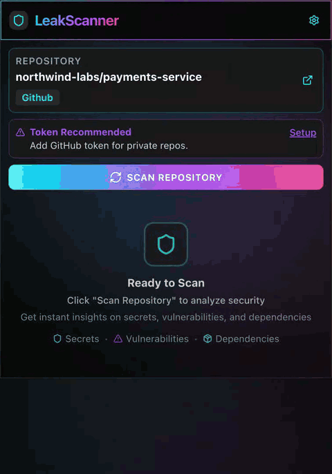
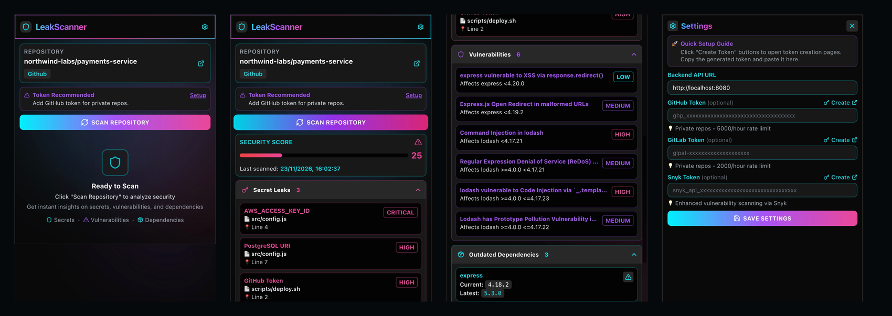
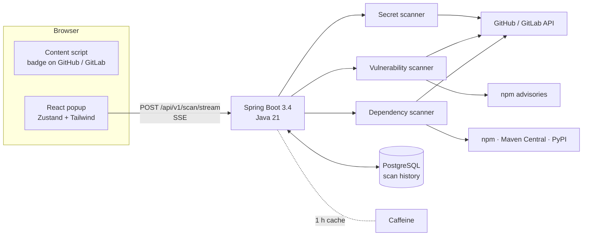

<div align="center">



# LeakScanner

**A Chrome extension that scans the GitHub or GitLab repository you are looking at for leaked secrets, vulnerable npm packages and outdated dependencies, and gives it a security score from 0 to 100.**

[](LICENSE)


[How it works](#how-it-works) · [What it detects](#what-it-detects) · [Run it locally](#run-it-locally) · [API](#api)

</div>

## How it works

1. Open any repository on GitHub or GitLab. The extension reads the owner and name from the page and shows a small security badge on it.
2. Click the toolbar icon, then **Scan Repository**. The popup sends the repository to the Spring Boot backend and streams results back as they arrive, so dependencies show up first and secrets and advisories follow.
3. You get a security score, every leaked secret with its file and line, the known advisories for your npm packages, and which dependencies are behind their latest release.



> **About these screenshots:** they show a made-up repository, `northwind-labs/payments-service`, with invented credentials, served by a local stand-in for the GitHub API. Everything after that is the real code: the scanner runs on the stand-in's files, and the npm advisories and latest versions come from the live npm registry.

## What it detects

| Check | How | Examples |
|---|---|---|
| **Secret leaks** | 15 regular expressions with false-positive filtering | AWS access keys, GitHub and GitLab tokens, Stripe and Slack keys, private keys, JWTs, Google and Firebase keys, MongoDB, PostgreSQL and MySQL URIs, hardcoded passwords |
| **Vulnerable packages** | Exact `package.json` versions sent to the npm bulk advisory API | lodash, express and axios advisories with severity, affected range and a link to the GitHub advisory |
| **Code risks** | Pattern checks on source files | SQL injection, XSS, command injection, hardcoded credentials, weak randomness, weak crypto |
| **Outdated dependencies** | Latest release from npm, Maven Central and PyPI | `package.json`, `pom.xml`, `requirements.txt` |
| **Snyk** | Optional, when you add a Snyk token in settings | Deeper vulnerability data |

Every secret is shown masked, and tokens you enter in the settings stay in Chrome storage and are only sent to your own backend as request headers.

The score starts at 100 and loses points per finding: secrets cost 20, 10, 5 or 2 (critical to low), vulnerabilities cost 15, 8, 4 or 1, and outdated dependencies cost 2 each up to 20.

## Architecture



- The three scanners run in parallel and publish partial results as they finish, which is what the popup renders live.
- Scan history is stored in PostgreSQL. A repository scanned within the last hour returns its saved result instead of scanning again.
- An optional AWS Lambda handler lives in [`aws-lambda/`](aws-lambda/).

## Tech stack

| Layer | Tools |
|---|---|
| Extension | React 18, TypeScript, Vite, Tailwind CSS, Zustand, Lucide icons, Chrome Manifest V3 |
| Backend | Spring Boot 3.4, Java 21, Spring Web and WebFlux `WebClient`, Spring Data JPA, Caffeine, Lombok |
| Data | PostgreSQL 15 |
| External APIs | GitHub, GitLab, npm registry and advisories, Maven Central, PyPI, Snyk (optional) |
| Delivery | Docker Compose |

## Run it locally

You need Docker, plus Node.js 18+ for the extension.

```bash
git clone https://github.com/Bogdusik/LeakScanner.git
cd LeakScanner
cp .env.example .env        # set POSTGRES_PASSWORD and DB_PASSWORD
docker compose up -d        # PostgreSQL + backend on http://localhost:8080
```

Then build and load the extension:

```bash
cd chrome-extension
npm install
npm run build
```

1. Open `chrome://extensions` and switch on **Developer mode**.
2. Click **Load unpacked** and pick `chrome-extension/dist`.
3. Open any repository on GitHub or GitLab and click the LeakScanner icon.

Without Docker: create a database (`createdb leakscanner && psql -d leakscanner -f database/init.sql`), export `DB_USERNAME` and `DB_PASSWORD`, then run `mvn spring-boot:run` in `backend/` (Java 21 and Maven 3.9).

**Tokens.** A GitHub or GitLab token is optional, but it lifts the API rate limit and is required for private repositories. Add tokens in the popup's settings panel. The backend URL defaults to `http://localhost:8080`.

### Tests

```bash
cd backend && mvn test
```

## API

Tokens go in the `X-GitHub-Token`, `X-GitLab-Token` and `X-Snyk-Token` headers and are never stored.

| Endpoint | Description |
|---|---|
| `POST /api/v1/scan` | Scan a repository and return the full result |
| `POST /api/v1/scan/stream?force=true` | Same scan as a Server-Sent Events stream. `force=true` skips the one-hour saved result |
| `GET /api/v1/scan/history?owner=&name=&platform=` | Previous scans of a repository |
| `GET /llms.txt` | This API in Markdown, for LLM tools |

```bash
curl -X POST http://localhost:8080/api/v1/scan \
  -H 'Content-Type: application/json' \
  -d '{"owner":"octocat","name":"Hello-World","platform":"github"}'
```

## Project structure

```
LeakScanner/
├── chrome-extension/   # React popup, content script, background worker, API client
├── backend/            # Spring Boot: controllers, scanners, JPA entities, tests
├── database/init.sql   # Schema: repositories, scan results, secrets, vulnerabilities
├── aws-lambda/         # Optional Lambda handler
└── docker-compose.yml  # PostgreSQL + backend
```

## Limits

- A scan reads up to 30 files on GitHub and 50 on GitLab, so very large repositories are sampled and not covered completely.
- Advisory lookups need exact versions in `package.json`; ranges such as `latest` or git URLs are skipped.
- Lines containing words like `example`, `placeholder` or `xxx`, and files under test, example or mock paths, are ignored to cut false positives. A real secret in such a file will not be reported.
- See [PRODUCTION_CHECKLIST.md](PRODUCTION_CHECKLIST.md) before exposing the backend beyond localhost.

## What I learned

- **Reading real streams, not assumed ones:** Spring's `SseEmitter` writes `data:{…}` without the space the popup's parser expected, so no streamed event was ever parsed until I wrote a tolerant parser.
- **Shared mutable state in a reactive client:** one singleton `WebClient.Builder` collected every request's auth headers, which is how a token could end up on a call to another host. Cloning the builder per call fixed it, with a regression test.
- **Trusting external APIs less:** the npm audit endpoint the project used had stopped accepting requests, and the bulk advisory endpoint returns `application/octet-stream`; both only showed up by running against the real service.
- **Reducing false positives:** a scanner that cries wolf gets ignored, so test paths, comments and placeholder values are filtered out.
- **Chrome extension plumbing:** Manifest V3 service workers, content scripts that inject UI into someone else's page, and extension-to-backend CORS.

## License

[MIT](LICENSE)
